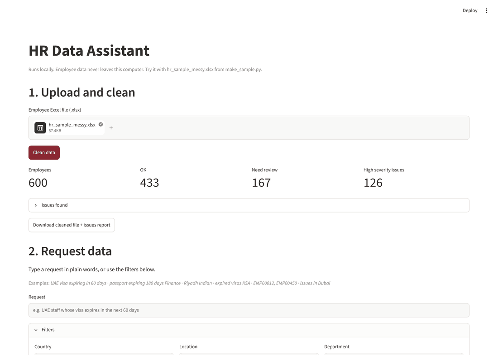

# HR Data Quality Tool


Cleans a messy HR employee master file, flags every data problem with its original Excel row number, and answers HR requests such as "UAE staff whose visa expires in the next 60 days" in one command or one click.

Built as a prototype for a UAE HR team that tracked passports and visas in large Excel extracts. All data in this repository is invented.



## Why

HR master files collect errors over years: dates typed in five formats, impossible dates like 31/02, visas marked "Valid" after they expired, the same employee ID on two people. Finding these by hand takes hours, and pulling a list like "Finance staff with passports expiring in 6 months" means filtering and fixing dates every time.

## What it checks

- Dates in mixed formats, impossible dates and text in date columns ("TBC")
- Missing values in required fields
- Passport expired, under 180 days left, or expiry on or before issue date
- Visa status "Valid" when the expiry date has passed
- Visas expiring within 90 days, and visas that outlast the passport
- UAE nationals recorded with a work visa
- Passport number format and invalid emails
- Exact duplicate rows, and IDs or passport numbers shared across records

It also standardises country and visa status spellings ("U.A.E", "uae ", "United Arab Emirates" all become "UAE"), name case and passport case. Unknown values are flagged, never guessed.

## Result on the sample file

The generator creates 608 rows with planted errors. One run:

```text
$ python hr_tool.py clean hr_sample_messy.xlsx
Cleaned 608 rows -> hr_clean.xlsx. 227 issues on 167 employees.
```

| Severity | Problem | Count |
| --- | --- | --- |
| High | Status "Valid" but visa expiry date has passed | 46 |
| High | Not a valid date | 22 |
| High | Passport expired | 15 |
| High | Same Employee ID used for different records | 8 |
| Medium | Visa expires within 90 days | 22 |
| Low | Exact duplicate row (removed) | 8 |

Counts depend on the run date because expiry checks are relative to today.

The output workbook has three sheets: `Clean_Data`, `Issues` (with source row numbers) and `Summary`.

## Run it

```sh
python3 -m venv .venv
.venv/bin/pip install -r requirements.txt

.venv/bin/python make_sample.py                       # creates hr_sample_messy.xlsx (fake data)
.venv/bin/python hr_tool.py clean hr_sample_messy.xlsx --out hr_clean.xlsx
```

Answer a request:

```sh
python hr_tool.py query hr_clean.xlsx --country UAE --visa-expiring 60 --out uae_visa_60d.xlsx
python hr_tool.py query hr_clean.xlsx --dept Finance --passport-expiring 180
python hr_tool.py query hr_clean.xlsx --issues-only --out issues_for_hr.xlsx
```

Web app (runs locally, no data leaves the machine):

```sh
.venv/bin/streamlit run app.py
```

## Using it on a real file

Edit the `COLS` block at the top of `hr_tool.py` to match the file's headers, and add any local spellings to `COUNTRY_MAP` and `VISA_MAP`. Nothing else needs changing.

## Files

| File | What it is |
| --- | --- |
| `hr_tool.py` | Cleaning, validation and query logic (CLI) |
| `app.py` | Streamlit front end with plain-language requests |
| `make_sample.py` | Generates a fake messy HR file for testing |
| `tests/` | pytest tests |

## Licence

MIT
